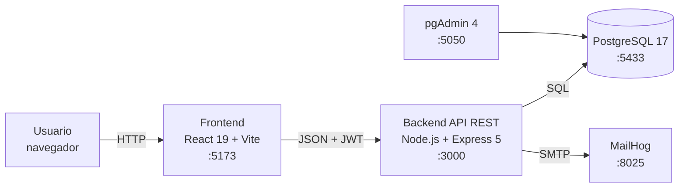
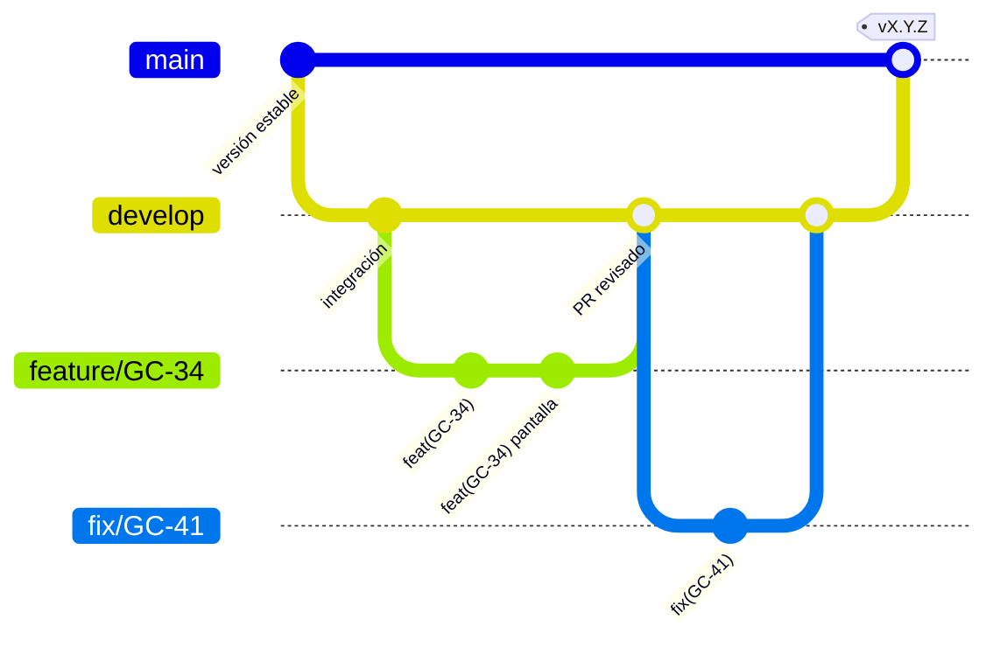
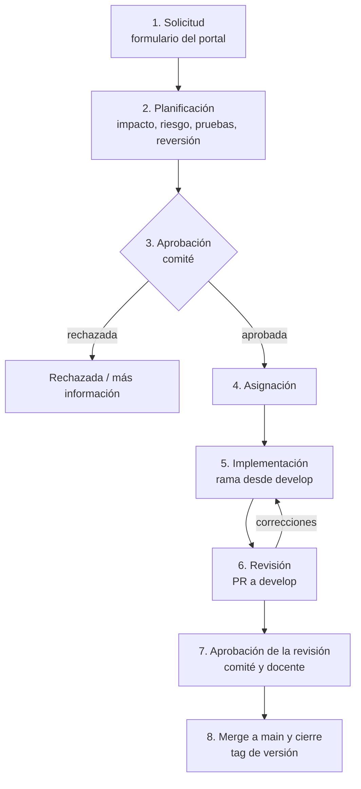

# Pasajes Ecuador

**Sistema web para la gestión y venta de pasajes de bus interprovinciales en Ecuador.**

Proyecto del segundo parcial de **Manejo y Configuración de Software** — Universidad Técnica de Ambato, Facultad de Ingeniería en Sistemas, Electrónica e Industrial (FISEI), Carrera de Software, ciclo julio – diciembre 2026.


---

## Tabla de contenido

- [Descripción](#descripción)
- [Funcionalidades por rol](#funcionalidades-por-rol)
- [Reglas de negocio implementadas](#reglas-de-negocio-implementadas)
- [Arquitectura](#arquitectura)
- [Tecnologías](#tecnologías)
- [Instalación rápida con Docker](#instalación-rápida-con-docker)
- [Usuarios de prueba](#usuarios-de-prueba)
- [Recorridos de prueba](#recorridos-de-prueba)
- [Base de datos](#base-de-datos)
- [Estructura del proyecto](#estructura-del-proyecto)
- [API REST](#api-rest)
- [Gestión de la configuración](#gestión-de-la-configuración)
- [Cómo contribuir](#cómo-contribuir)
- [Comandos útiles](#comandos-útiles)
- [Solución de problemas](#solución-de-problemas)
- [Instalación sin Docker](#instalación-sin-docker)
- [Equipo](#equipo)

---

## Descripción

**Pasajes Ecuador** conecta a las cooperativas de transporte interprovincial con sus pasajeros:

- Las **cooperativas** registran sus buses, sus frecuencias autorizadas por la ANT (con paradas intermedias) y su hoja de ruta semanal.
- Los **oficinistas** venden boletos en ventanilla y validan los pagos por transferencia o depósito.
- Los **clientes** buscan viajes, eligen su asiento, compran con los descuentos de ley y descargan su boleto con código QR.
- El **personal del bus** inicia el viaje, valida los boletos con la cámara, vende a bordo y lo finaliza.
- El **administrador** gestiona las cooperativas, los usuarios, los catálogos y la apariencia de la aplicación.

Todo el desarrollo se gestionó con **Git + GitHub (GitFlow)** para el control de versiones y **Jira Service Management** para el control de cambios, siguiendo el flujo de ITIL.

---

## Funcionalidades por rol

| Rol | Qué puede hacer |
|---|---|
| **Cliente** | Registrarse y confirmar su correo · buscar viajes, incluso entre paradas intermedias · filtrar por cooperativa, tipo de asiento, marca de chasis y carrocería y tipo de viaje · ver el detalle del bus (número, placa, marcas, fotografía, servicios) · elegir asientos en el mapa del bus · comprar con descuentos (tercera edad, menor de edad, discapacidad) · subir el comprobante de pago · ver **Mis boletos** (próximos, por pagar e historial) · descargar el boleto en PDF con QR · recibir notificaciones · gestionar **Mi cuenta** |
| **Oficinista** | Vender boletos en ventanilla con mapa de asientos y descuentos · validar comprobantes (aprobar o rechazar con motivo) · imprimir boletos |
| **Cooperativa** | Datos y apariencia (logo, colores, contacto) · tipos de asiento con factor de precio · buses con estructura de asientos por piso, ficha técnica y matrícula · frecuencias con resolución ANT y paradas · grupos de buses y **hoja de ruta semanal** manual o automática con días de parada · personal (oficinistas, choferes y ayudantes con licencia) · **rutas destacadas** dentro de su plan |
| **Personal del bus** | **Viajes de hoy** · iniciar el viaje (desde 60 min antes de la salida) · validar boletos con la cámara o el código · lista de pasajeros · **venta a bordo** en efectivo con cálculo del vuelto · finalizar el viaje con observaciones · historial de viajes y lo recaudado |
| **Administrador** | Cooperativas con su usuario responsable · usuarios y asignación de roles · catálogos (marcas, provincias y cantones) · plan de rutas destacadas por cooperativa · configuración de la aplicación (nombre, logo, colores, redes sociales, soporte y cuenta bancaria) |

Todos los usuarios reciben **notificaciones dentro de la aplicación** en cada paso relevante, y **correos electrónicos** para confirmar la cuenta y recuperar la contraseña.

---

## Reglas de negocio implementadas

| Regla | Implementación |
|---|---|
| Múltiples cooperativas | Cada una con RUC validado y una cuenta nueva para su responsable. |
| Frecuencias asignadas por la ANT | Origen, destino, hora y número de resolución; pueden estar activas o inactivas. |
| Paradas intermedias | Paradas ordenadas con tiempo y precio acumulado; se venden tramos (ej. Latacunga → Cuenca en Quito → Loja). |
| Hoja de ruta según frecuencias y buses | Generación manual o automática por grupos; el exceso de buses produce días de parada **P**. |
| Asientos por cooperativa | Tipos de asiento propios (Normal, VIP…) con factor de precio; estructura de cada bus por pisos. |
| Disponibilidad real | Solo se muestran los asientos libres para el tramo elegido; la venta doble se evita con transacciones. |
| Descuentos validados con la cédula | 50 % para tercera edad, menores y personas con discapacidad; la cédula se valida con el algoritmo del Registro Civil y la edad con la fecha de nacimiento. |
| Pago por transferencia o depósito | El cliente sube el comprobante y el oficinista lo valida. Las reservas sin comprobante **vencen a los 30 minutos** y liberan los asientos. |
| Boleto disponible siempre | PDF con QR descargable desde *Mis boletos* en cualquier momento. |
| Acceso al bus | El chofer escanea el QR; un boleto solo sirve una vez y solo en su viaje. |
| Rutas destacadas | La cooperativa paga fuera del sistema; el administrador registra el cupo y la vigencia, y los viajes destacados salen primero en la búsqueda. |

---

## Arquitectura



- **Frontend:** aplicación de una sola página; cada rol ve solo su menú y sus pantallas (rutas protegidas).
- **Backend:** API REST organizada por módulos (`routes → controller → service`); autenticación con JWT y control de roles en cada ruta; errores centralizados con mensajes claros para el usuario.
- **Base de datos:** modelo relacional versionado en scripts SQL numerados.
- **Docker Compose:** levanta los cinco servicios con un solo comando y conserva los datos entre reinicios.

---

## Tecnologías

| Capa | Tecnología |
|---|---|
| Frontend | React 19, Vite, React Router 7, Axios, html5-qrcode, ESLint |
| Backend | Node.js 22, Express 5, JWT, bcryptjs, multer, pdfkit, qrcode, nodemailer |
| Base de datos | PostgreSQL 17 |
| Infraestructura | Docker, Docker Compose, pgAdmin 4, MailHog |
| Control de versiones | Git, GitHub, GitFlow, Conventional Commits |
| Control de cambios | Jira Service Management (espacio **Control de Cambio-Buses**, clave `GC`) |

---

## Instalación rápida con Docker

> Recomendada: no hace falta instalar PostgreSQL ni Node.js, y todo el equipo trabaja con el mismo entorno.

### Requisitos

- [Git](https://git-scm.com/)
- [Docker Desktop](https://www.docker.com/products/docker-desktop/) abierto

### Pasos

Clona **fuera de OneDrive** (OneDrive bloquea `node_modules`):

```bash
mkdir -p /c/dev && cd /c/dev
git clone https://github.com/ViniD2005/ProyectoManejoBuses.git
cd ProyectoManejoBuses
git checkout develop
cp .env.example .env          # opcional: cambia JWT_SECRET
docker compose up -d --build  # la primera vez tarda unos minutos
```

| Servicio | Dirección | Acceso |
|---|---|---|
| Aplicación | http://localhost:5173 | usuarios de prueba (abajo) |
| API | http://localhost:3000/api | — |
| MailHog (correos de prueba) | http://localhost:8025 | — |
| pgAdmin | http://localhost:5050 | `admin@admin.com` / `admin` · servidor *Pasajes Ecuador*, contraseña `postgres` |
| PostgreSQL | `localhost:5433` | `postgres` / `postgres` · base `buses_db` |

La primera vez, PostgreSQL ejecuta en orden todos los scripts de `backend/database`. Después **ya no se vuelven a ejecutar**: lo que registres queda guardado en el volumen `datos_postgres`.

El código de `backend/src` y `frontend` se edita en tu PC y se recarga solo (nodemon y Vite).

### Variables de entorno

| Archivo | Variable | Para qué |
|---|---|---|
| `.env` (raíz, Docker) | `DB_USER`, `DB_PASSWORD` | Credenciales de PostgreSQL |
| | `JWT_SECRET` | Clave para firmar las sesiones (cadena larga y aleatoria) |
| `backend/.env` (sin Docker) | `PORT`, `FRONTEND_URL` | Puerto de la API y origen permitido |
| | `DB_HOST`, `DB_PORT`, `DB_NAME`, `DB_USER`, `DB_PASSWORD` | Conexión a PostgreSQL |
| | `SMTP_HOST`, `SMTP_PORT`, `SMTP_FROM` | Servidor de correo (MailHog en desarrollo) |
| | `RESERVA_MINUTOS` | Minutos para subir el comprobante antes de que venza la reserva (por defecto 30) |

> Nunca subas un archivo `.env` al repositorio.

---

## Usuarios de prueba

Contraseña de todos: **`Clave123*`**

| Rol | Correo |
|---|---|
| Administrador | `admin@pasajes.local` |
| Cooperativa (Cooperativa Andina) | `coop@andina.local` |
| Oficinista (Cooperativa Andina) | `oficina@andina.local` |
| Personal del bus — chofer (Cooperativa Andina) | `chofer@andina.local` |
| Cliente | `cliente@pasajes.local` |
| Cliente de tercera edad | `adultomayor@pasajes.local` |

---

## Recorridos de prueba

### Compra en línea

1. **Buscar pasajes** → Latacunga → Cuenca, fecha de hoy, 2 pasajeros → **Ver detalle** → **Seleccionar asientos**.
2. Elige 2 asientos → **Continuar con la compra** → inicia sesión como cliente.
3. Pasajero 2 con cédula `1712345675` y descuento **Tercera edad** → **Confirmar compra**.
4. **Mis boletos → Por pagar** → sube el comprobante (JPG, PNG o PDF) con su referencia, antes de 30 minutos.
5. Como oficinista → **Validar pagos** → **Aprobar pago**.
6. Como cliente → **Mis boletos → Próximos viajes** → **Descargar boleto** (PDF con QR).

### Viaje del chofer

1. Como oficinista vende en ventanilla un boleto de un viaje de hoy.
2. Como `chofer@andina.local` → **Viajes de hoy** → **Iniciar viaje** (habilitado desde 60 minutos antes de la salida).
3. **Validar boletos** → escanea el QR o escribe el código del boleto → «Boleto válido: puede abordar».
4. **Vender a bordo** → elige tramo y asiento → cobra en efectivo y revisa el vuelto.
5. **Finalizar** → escribe observaciones → el viaje aparece en **Mi historial**.

### Correos con MailHog

1. Regístrate en http://localhost:5173/registro.
2. Abre http://localhost:8025 → correo *«Confirma tu correo para activar tu cuenta»* → **Confirmar mi correo**.
3. En **Iniciar sesión → ¿Olvidaste tu contraseña?** pide el enlace y ábrelo desde MailHog.

| Regla | Valor |
|---|---|
| Enlace de confirmación | 24 horas, un solo uso |
| Enlace de recuperación | 30 minutos, un solo uso |
| Reenviar un correo | cada 60 segundos |

> Si MailHog está apagado, el enlace se escribe en `docker compose logs backend`.

---

## Base de datos

Los cambios de estructura se versionan como **scripts SQL numerados** en `backend/database`. Todos los scripts nuevos se pueden ejecutar varias veces sin error.

| Script | Contenido |
|---|---|
| `001_esquema.sql` | Estructura base: roles, usuarios, cooperativas, ciudades, buses, asientos, frecuencias, paradas, viajes, compras, boletos, notificaciones |
| `002_datos_prueba.sql` | Datos de prueba: cooperativas, usuarios por rol, buses, frecuencias y viajes |
| `003_turnos.sql` | Primera versión de turnos de la hoja de ruta |
| `004_personal_bus.sql` | Rol y usuario del personal del bus |
| `005_apariencia_cooperativa.sql` | Logo, colores y datos públicos de cada cooperativa |
| `006_ruc_validos.sql` | RUC válidos para las cooperativas de prueba |
| `007_verificacion_correo.sql` | Tokens de confirmación de correo y recuperación de contraseña |
| `008_provincias_cantones.sql` | Provincias y cantones del Ecuador |
| `009_marcas.sql` | Catálogo de marcas de chasis y carrocería |
| `010_estructura_asientos.sql` | Estructura de asientos por pisos |
| `011_grupos_hoja_ruta.sql` | Grupos de buses y hoja de ruta semanal con días de parada |
| `012_datos_bus.sql` | Ficha técnica, servicios y fotografía del bus |
| `013_chofer.sql` | Chofer, inicio y fin del viaje, observaciones y venta a bordo |
| `014_rutas_destacadas.sql` | Plan de rutas destacadas y marca en la frecuencia |
| `015_validaciones_personal.sql` | Cargo y licencia del personal del bus |
| `016_tipo_asiento_inicial.sql` | Tipo de asiento «Normal» para las cooperativas que no tienen ninguno |

Cuando un PR agrega un script, quien ya tiene la base creada lo aplica así (en Git Bash, la ruta empieza con `//`):

```bash
docker compose exec db psql -U postgres -d buses_db -f //docker-entrypoint-initdb.d/016_tipo_asiento_inicial.sql
```

---

## Estructura del proyecto

```
ProyectoManejoBuses/
├── backend/
│   ├── database/            scripts SQL numerados (001 … 016)
│   ├── uploads/             fotos, logos y comprobantes subidos (no se versionan)
│   ├── Dockerfile
│   └── src/
│       ├── config/          conexión a PostgreSQL y transacciones
│       ├── middlewares/     autenticación, roles, errores y subida de archivos
│       ├── modules/         un módulo por funcionalidad: *.routes.js, *.controller.js, *.service.js
│       ├── utils/           validaciones (cédula, teléfono, fechas…), correo, notificaciones, vencimiento de reservas
│       ├── app.js           registro de rutas
│       └── server.js        arranque del servidor y tareas periódicas
├── frontend/
│   ├── Dockerfile
│   └── src/
│       ├── components/      componentes reutilizables (íconos, diálogos, buscadores…)
│       ├── context/         sesión del usuario
│       ├── hooks/           configuración y diálogos
│       ├── layouts/         menú lateral, barra superior y pie de página
│       ├── pages/           una carpeta por rol: admin, cooperativa, oficinista, chofer, cliente, auth, cuenta
│       ├── services/        cliente HTTP (api.js)
│       └── utils/           validaciones y tema de la cooperativa
├── docker/                  configuración de pgAdmin
├── .github/                 plantillas de pull request y de reporte de errores
├── docker-compose.yml
└── README.md
```

---

## API REST

Base: `http://localhost:3000/api`. Las rutas protegidas reciben `Authorization: Bearer <token>`.

| Recurso | Uso principal | Roles |
|---|---|---|
| `/auth` | Registro, confirmación de correo, inicio de sesión y recuperación de contraseña | Público |
| `/cuenta` | Datos propios y cambio de contraseña | Cualquier usuario |
| `/viajes` | Búsqueda con filtros, detalle y asientos disponibles | Público |
| `/ciudades`, `/provincias`, `/marcas` | Catálogos | Público / admin |
| `/compras` | Compra en línea, venta en ventanilla, comprobantes, historial | Cliente, oficinista |
| `/pagos` | Validación de comprobantes | Oficinista |
| `/boletos` | Boleto en PDF con QR | Cliente, oficinista |
| `/chofer` | Viajes de hoy, iniciar, validar, vender a bordo, finalizar, historial | Personal del bus |
| `/cooperativas`, `/apariencia` | Gestión de cooperativas y su apariencia | Admin, cooperativa |
| `/buses`, `/estructura-buses`, `/tipos-asiento` | Flota y asientos | Cooperativa |
| `/frecuencias`, `/grupos`, `/hojas-ruta` | Frecuencias, grupos y hoja de ruta | Cooperativa |
| `/destacadas` | Plan de rutas destacadas y marca de frecuencias | Admin, cooperativa |
| `/usuarios` | Usuarios, roles, cargo y licencia | Admin, cooperativa |
| `/configuracion` | Configuración general de la aplicación | Admin (lectura pública) |
| `/notificaciones`, `/panel` | Notificaciones e indicadores del panel | Usuarios con sesión |

---

## Gestión de la configuración

### Control de versiones — GitFlow



| Rama | Nace de | Se integra en | Uso |
|---|---|---|---|
| `main` | — | — | Versiones estables y etiquetadas |
| `develop` | `main` | `main` | Integración del equipo (rama por defecto) |
| `feature/GC-n-descripcion` | `develop` | `develop` por PR | Funcionalidad nueva |
| `fix/GC-n-descripcion` | `develop` | `develop` por PR | Corrección |
| `hotfix/GC-n-descripcion` | `develop` | `develop` y `main` | Cambio de emergencia |

**Reglas:**

- Nadie sube cambios directamente a `develop` ni a `main`: todo entra por **pull request revisado**.
- Cada rama lleva la clave de su petición de Jira (`GC-n`).
- Los commits siguen **[Conventional Commits](https://www.conventionalcommits.org/es/v1.0.0/)** con la clave como ámbito y son pequeños y ordenados:

| Tipo | Uso | Ejemplo |
|---|---|---|
| `feat` | Funcionalidad nueva | `feat(GC-34): pantalla de viajes de hoy con inicio del viaje` |
| `fix` | Corrección | `fix(GC-41): crear el tipo de asiento Normal al registrar una cooperativa` |
| `refactor` | Reorganizar sin cambiar comportamiento | `refactor(GC-34): reutilizar el mapa del bus de la ventanilla` |
| `style` | Estilos | `style(GC-31): número de asiento legible en el boleto` |
| `docs` | Documentación | `docs(GC-42): actualizar el README` |
| `chore` | Mantenimiento y versiones | `chore(release): llevar a main los cambios revisados` |

### Control de cambios — Jira Service Management

Espacio **Control de Cambio-Buses** (clave `GC`). Toda modificación del sistema empieza como **petición de cambio**.

**Comité de control de cambios:** Erick Arias (Vini) y Damián Bastidas. Ninguno aprueba su propia petición.

**Formularios del portal:** uno para el **usuario final** (lenguaje sencillo) y otro para **desarrolladores (RFC)** con título, descripción, tipo, categoría, componentes, justificación, impacto, riesgo, plan de pruebas, plan de reversión, rama, esfuerzo y fecha. El comité puede modificarlos.

**Tipos de cambio (ITIL 4):**

| Tipo | Cuándo | Tratamiento |
|---|---|---|
| **Estándar** | Repetitivo, de bajo riesgo, sin código | Preaprobado; se hace desde la aplicación y se registra en Jira |
| **Normal** | Cambia código o base de datos | Flujo completo: aprobación, rama, PR, revisión y merge a `main` |
| **Emergencia** | Fallo que afecta al servicio | Aprobación inmediata y paso a `main` tras la revisión interna |

**Flujo de una petición:**



La **auditoría de la configuración** se realiza con el dashboard y los informes de Jira junto con el historial de ramas, pull requests y tags de GitHub.

---

## Cómo contribuir

1. Registra la petición en Jira y espera a que esté **Aprobada**.
2. Crea tu rama desde `develop`:
   ```bash
   git checkout develop
   git pull origin develop
   git checkout -b feature/GC-n-descripcion
   ```
3. Haz commits pequeños con Conventional Commits.
4. Antes de abrir el PR:
   ```bash
   cd frontend
   npm run lint
   npm run build
   ```
   Prueba con Docker; si agregaste un script SQL, que se pueda ejecutar varias veces.
5. Sube la rama y abre el **pull request hacia `develop`** con la plantilla: clave de Jira, tipo de cambio ITIL, qué cambia, cómo probarlo y scripts de base de datos.
6. Un miembro del comité distinto del autor revisa, prueba y acepta. Mueve la petición en Jira a **revisión** con el enlace del PR.
7. Después de cada merge, todos actualizan:
   ```bash
   git checkout develop
   git pull origin develop
   docker compose restart backend
   ```
   y ejecutan el script SQL nuevo, si lo hay.

---

## Comandos útiles

| Necesito… | Comando |
|---|---|
| Levantar todo | `docker compose up -d` |
| Reconstruir tras instalar una dependencia | `docker compose up -d --build` |
| Apagar (conserva los datos) | `docker compose down` |
| Empezar de cero (**borra la base**) | `docker compose down -v` y `docker compose up -d --build` |
| Ver los mensajes del backend | `docker compose logs -f backend` |
| Reiniciar el backend | `docker compose restart backend` |
| Ejecutar un script SQL | `docker compose exec db psql -U postgres -d buses_db -f //docker-entrypoint-initdb.d/0XX.sql` |
| Revisar el frontend | `cd frontend && npm run lint` |
| Compilar el frontend | `cd frontend && npm run build` |
| Empaquetar `develop` en un zip | `git archive --format=zip -o develop.zip develop` |

---

## Solución de problemas

| Síntoma | Causa probable | Solución |
|---|---|---|
| «Ocurrió un problema inesperado» al abrir la página | El backend se está reiniciando o tiene un error | `docker compose logs --tail 20 backend`; espera a ver «API escuchando…» y recarga con **Ctrl + F5** |
| Pantalla roja de Vite «Failed to resolve import» | Un archivo importado ya no existe (conflicto mal resuelto) | Revisa `App.jsx` contra `develop` en GitHub y vuelve a hacer `git pull` |
| Error de columna o tabla inexistente | Falta ejecutar un script SQL nuevo | Ejecuta el script indicado en el PR |
| `git pull` dice que tus cambios se sobrescribirían | Tienes cambios locales sin guardar | `git stash push -m "cambios locales"` y vuelve a hacer `git pull` |
| `npm install` falla dentro de OneDrive | OneDrive bloquea `node_modules` | Clona el proyecto en `C:\dev` |
| En Git Bash la ruta `/docker-entrypoint-initdb.d/...` no existe | Git Bash convierte las rutas que empiezan con `/` | Escribe la ruta con `//` al inicio |
| `Copy-Item: command not found` | Es un comando de PowerShell | En Git Bash usa `cp -r origen/. .` |

---

## Instalación sin Docker

<details>
<summary>Ver los pasos</summary>

Requisitos: Git, Node.js 22 LTS, PostgreSQL 17 con pgAdmin 4.

1. **Base de datos:** en pgAdmin crea la base `buses_db` y ejecuta en orden (Query Tool, **F5**) todos los scripts de `backend/database`, del `001` al último.
2. **Backend:**
   ```bash
   cd backend
   npm install
   cp .env.example .env    # pon tu contraseña de PostgreSQL y un JWT_SECRET propio
   npm run dev
   ```
   Para generar un `JWT_SECRET`:
   ```bash
   node -e "console.log(require('crypto').randomBytes(48).toString('hex'))"
   ```
3. **Frontend** (otra terminal):
   ```bash
   cd frontend
   npm install
   npm run dev
   ```
4. Abre http://localhost:5173. Para los correos, ejecuta MailHog en el puerto 1025/8025 o revisa el enlace en la consola del backend.

</details>

---

## Equipo

| Integrante | Rol |
|---|---|
| Arias Aseicha Erick Vinicio ([@ViniD2005](https://github.com/ViniD2005)) | Coordinador, dueño del repositorio y comité de control de cambios |
| Bastidas Freire Alan Damian | Desarrollador y comité de control de cambios |
| Barragan Garcia Danilo Fernando | Desarrollador |
| Moreta Viracocha Alvaro Matheo | Desarrollador |
| Sigcha Arcos Justin Israel | Desarrollador |

**Docente:** Ing. MSc. Santiago David Jara Moya — Manejo y Configuración de Software, UTA, 2026.

---

<sub>Proyecto académico sin fines comerciales. Los datos de cooperativas, usuarios y cuentas bancarias son de prueba.</sub>
